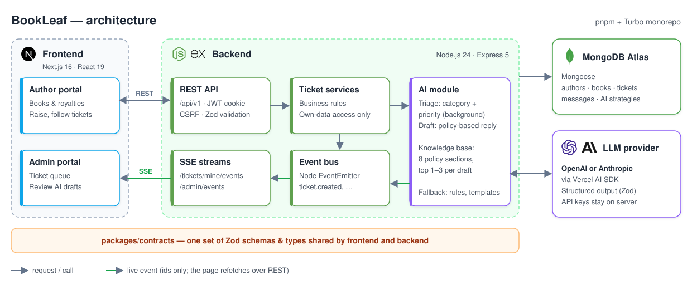
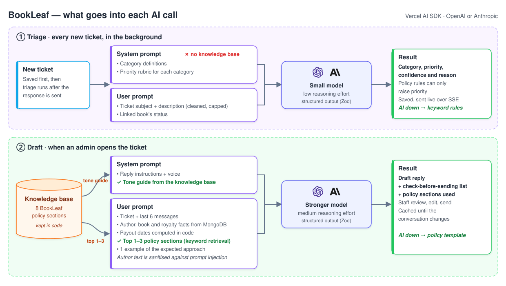

# BookLeaf — Author Support & Communication Portal

Authors track their books and royalties and raise support tickets. BookLeaf's support team
gets every ticket **sorted, prioritised and answered with an AI-drafted reply** based on
BookLeaf's policies, and a person always reviews it before it's sent.

## Run locally

This is a **pnpm + Turbo monorepo**: the portal (`apps/web`), the API (`apps/api`) and
shared packages (`packages/*`) install and run together from the repo root.

Needs:

- **Node 24** (`nvm use` picks it up from `.nvmrc`)
- **pnpm 12**
- **MongoDB**, local or Atlas
- **An OpenAI or Anthropic API key.** Both are supported; add a key for either one to get
  AI-categorised and prioritised tickets and drafted replies.

```bash
# Install packages
pnpm install

# Copy the env files and fill in the values
# In apps/api/.env set JWT_SECRET, AI_PROVIDER (openai or anthropic) and that provider's API key.
# Note: for seeding, SEED_DATA_PATH is the source (path to bookleaf_sample_data.json, saved
# anywhere) and MONGODB_URI is the target database.
cp apps/api/.env.example apps/api/.env
cp apps/web/.env.example apps/web/.env.local     # NEXT_PUBLIC_API_URL, defaults to the local API

# Seed the database (adds or updates records, never deletes existing data)
pnpm seed

# Run the API and the portal with one command
pnpm dev
```

Then open <http://localhost:3000/login?test-creds=1> and pick a test account.

## Live demo

|                   | URL                                                      |
| ----------------- | -------------------------------------------------------- |
| **Author portal** | <https://bookleaf.code26.site/author>                    |
| **Admin portal**  | <https://bookleaf.code26.site/admin>                     |
| **Backend API**   | <https://api.bookleaf.code26.site> (status at `/health`) |

Both portals sign in at `/login`. Open
**<https://bookleaf.code26.site/login?test-creds=1>** to see the test accounts with
one-click sign-in.

| Role                             | Email                                                   | Password      |
| -------------------------------- | ------------------------------------------------------- | ------------- |
| Admin                            | `support.lead@bookleaf.test`, `ops.agent@bookleaf.test` | `Admin@2026`  |
| Author                           | `priya.sharma@email.com` (any author in the dataset)    | `Author@2026` |
| Author with a book in production | `kavita.deshmukh@email.com`                             | `Author@2026` |
| Author with no payout yet        | `ananya.reddy@email.com`                                | `Author@2026` |

**Try it in 1 minute:** as an author, raise "I haven't received any royalty for 6 months".
In another browser, sign in as an admin. The ticket is already at the top of the queue,
marked High, with a draft reply ready. Edit it and send it, and the author sees it
instantly.

## How it solves BookLeaf's problem

**Situation:** BookLeaf's support team answers authors **by hand**. Replies are **slow and
inconsistent**, **urgent issues get buried** in the backlog, and authors keep asking
"**where is my royalty?**"

**Task:** Answer every author **quickly and accurately**, put **urgent tickets first**, and
let authors **help themselves**, without taking people out of the loop.

**Action:**

- Every new ticket is **auto-sorted into 6 categories** and given a **priority**; the queue
  shows the most urgent and oldest first.
- The AI **drafts a reply** that follows **BookLeaf's policies and tone** and uses the
  author's **real book and royalty figures**. Staff **review, edit and send** it.
- Authors see their **books, royalties, pending amounts and next payout date** themselves.
- Replies and status changes appear **live** on the author's ticket.
- Staff stay **in control**: they can change category and priority, add **internal notes**
  and tune the AI in plain language under **AI settings**.
- If the AI is down, tickets are **still created**, with **rule-based sorting** and
  **template replies**.

**Result:** Tickets arrive **sorted, prioritised and with a draft ready**, so staff reply in
**seconds** instead of writing from scratch. Answers are **consistent**, nothing urgent is
missed, and authors get **fewer reasons to ask**.

## Tech stack

| Part     | Technology                                                                                    |
| -------- | --------------------------------------------------------------------------------------------- |
| Frontend | Next.js 16, React 19, TypeScript, Ant Design 6, Tailwind CSS 4, TanStack Query, Zustand       |
| Backend  | Node.js 24, Express 5, TypeScript, Zod validation, JWT in HTTP-only cookie + CSRF protection  |
| Database | MongoDB (Atlas in production) with Mongoose                                                   |
| AI       | OpenAI or Anthropic via the Vercel AI SDK, structured output validated with Zod               |
| Live     | Server-Sent Events                                                                            |
| Tooling  | pnpm workspaces, Turborepo, Vitest + Supertest, ESLint, Prettier                              |

## How it's built



## AI, briefly



- **Sorting and priority:** one small, fast model call per new ticket returns the category,
  priority, confidence and reason. Policy rules can only raise priority (e.g. ISBN errors
  are at least High), and a staff member's change is never overwritten.
- **Draft replies:** a stronger model gets the ticket, the author's real book data, payout
  dates computed in code, and only the 1–3 relevant policy sections, not the whole
  knowledge base. It also returns a "check before sending" list.
- **Cost-aware:** drafts are cached until the conversation changes, history is limited to the
  last 6 messages, and every call's tokens are logged.
- **Safe failure:** timeouts, rate limits and bad output all fall back to rules and templates,
  with a circuit breaker to stop repeated failing calls.

## Why SSE instead of WebSockets

- **Updates only flow one way** (server → browser). Everything users do already goes
  through normal, validated REST calls.
- **It's plain HTTP**, so the same login cookie, permission checks and proxies work unchanged.
  No separate socket authentication is needed.
- **The browser has it built in** and reconnects on its own; the portal also falls back to
  polling every 20 seconds.
- **It can't leak data:** events only carry a ticket ID, and the browser then re-fetches
  through the secured API.

WebSockets would make sense for two-way features such as typing indicators or live chat.

## Deployment

| Part             | Hosted on                 |
| ---------------- | ------------------------- |
| Portal (Next.js) | **Zoho Catalyst Slate**   |
| API (Express)    | **Zoho Catalyst AppSail** |
| Database         | **MongoDB Atlas**         |

```bash
catalyst deploy --only appsail:bookleaf-api                          # builds and deploys the API
pnpm slate:prepare && catalyst deploy --only slate:bookleaf-portal   # packages and deploys the portal
```

- **API:** builds on your machine into a single self-contained `dist/` folder, and only that
  folder is uploaded.
- **Portal:** Slate builds it on Zoho's servers with npm. `slate:prepare` creates a small
  standalone copy of the web app and its shared packages in `.slate/` for it to build.
- **Secrets:** they live only in the Catalyst console, never in the repo.

## Testing

```bash
pnpm typecheck && pnpm lint && pnpm test
```

76 automated tests run against an in-memory MongoDB and a fake AI, so they make no network
calls. They cover login, permissions, authors seeing only their own data, ticket flows,
AI fallbacks and seeding.

## Known limitations

- Runs as a single API instance. Scaling out needs Redis for live updates, rate limits and
  background jobs.
- Attachments are UI only (not uploaded).
- No email notifications, password reset or MFA yet.
- No labelled evaluation set yet to measure AI accuracy over time.
